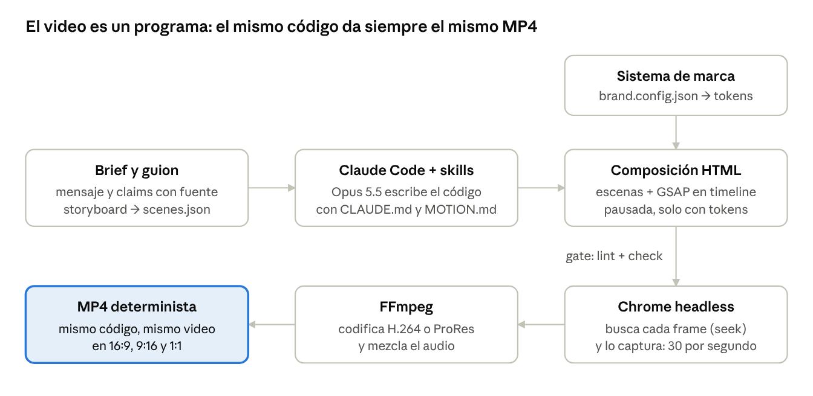
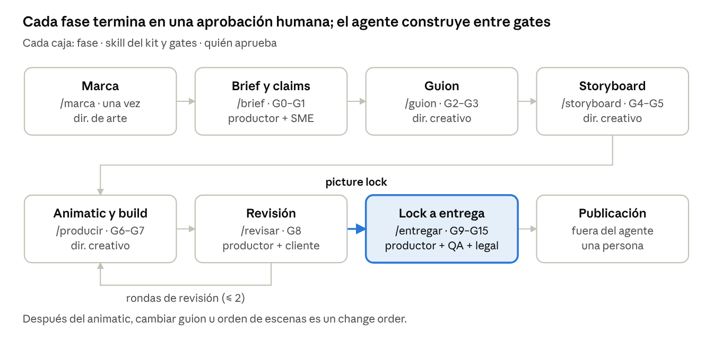
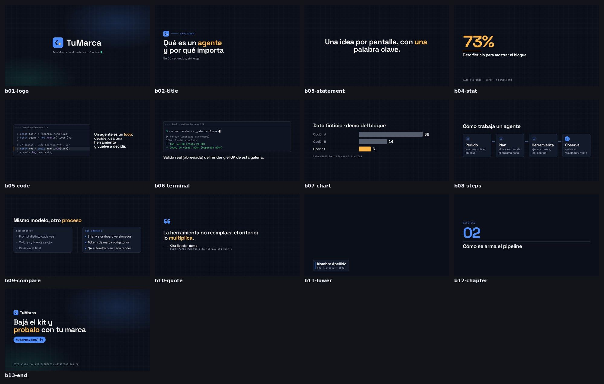
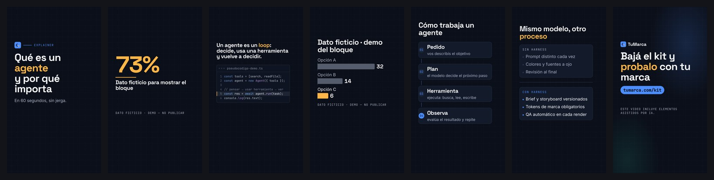
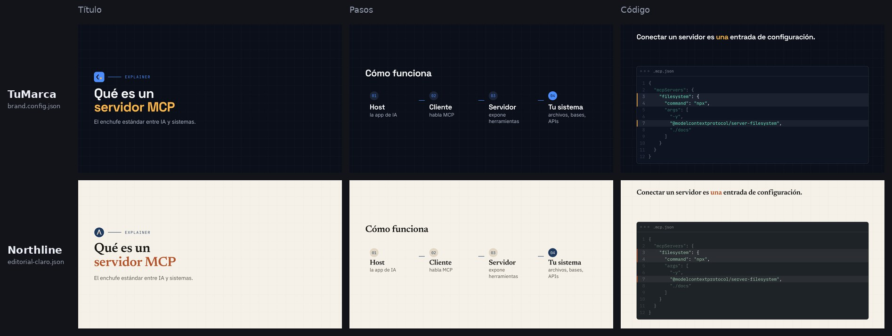
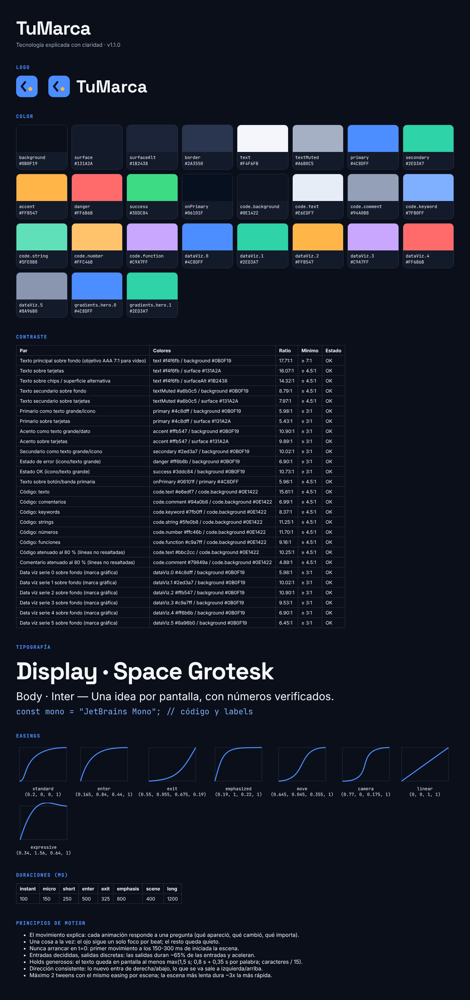
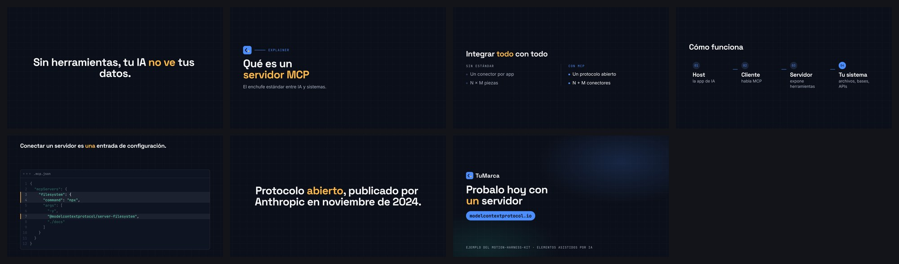
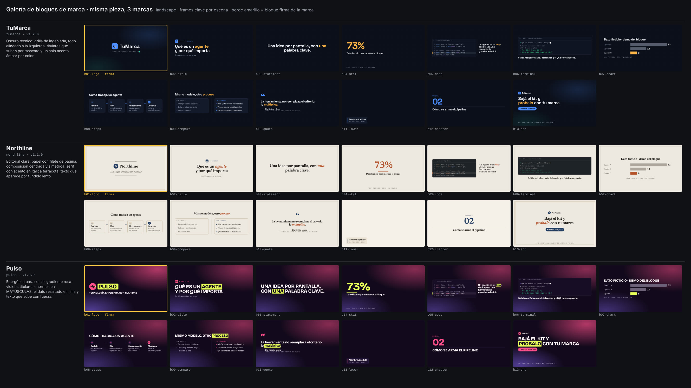
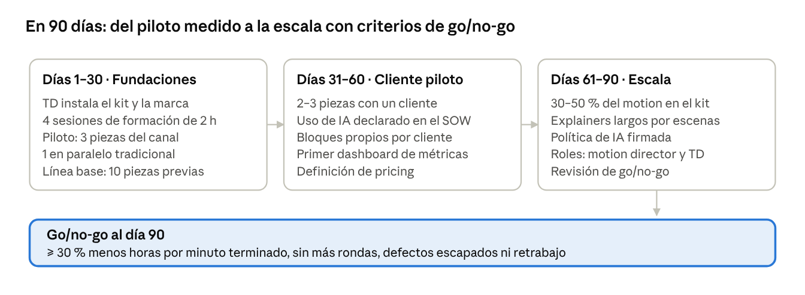

# Motion graphics con IA: guía de uso para el equipo de video

> Versión Markdown de la guía publicada (documento editable con comentarios en Claude Docs). Generada el 2026-10-19 para el kit v1.3. Para arrancar: el README (prompts de instalación, brandkit y primer video) y `docs/EMPEZAR.md`. Verificación: `docs/VERIFICACION.md`.

Oct 19, 2026 · @Facundo Lemos

Claude Code con Opus 5.5 ya produce motion graphics de calidad profesional escribiéndolos como código (HTML + GSAP renderizado a MP4 con HyperFrames). Rinde en explainers, datos, código y piezas para redes, pero solo con un harness: sistema de marca, gates humanos y QA automático. Esta guía explica el método de punta a punta y acompaña al kit `motion-harness-kit`, que lo implementa. Los términos técnicos se explican en el Glosario, al final.

## Veredicto en 60 segundos

Adoptarlo, pero como cambio de método y no como reemplazo de talento: la IA abarata construir, no decidir ni aprobar.

- **Funciona:** tipografía cinética, diagramas, data viz, código y terminal, lower thirds y variantes 16:9 / 9:16 / 4:5 / 1:1. El texto sale nítido y el render es determinista porque es código, no video generativo.
- **No funciona solo:** sin sistema de marca el resultado es genérico ("AI slop"); el modelo falla en jerarquía, composición y timing, y puede inventar cifras o código. El fabricante de HyperFrames lo admite en su propio benchmark.
- **Dónde está el ahorro:** en variantes y volumen. Contra un motion designer interno con plantillas, el ahorro por minuto estimado es de 1,5× a 3×; contra una agencia, hasta un orden de magnitud. Los tokens del modelo son lo de menos (USD 0,4–1 por clip de 12 s): lo que cuesta son las horas de dirección, verificación y QA.
- **Riesgo número uno en videos tech:** la exactitud. Ningún número, comando ni cita sale del modelo: sale de un archivo con fuente que firma un experto.
- **Qué cambia en el equipo:** el motion designer pasa a dirigir al agente y pulir el 10–20 % de escenas clave; aparece el rol de *technical director* (dueño del harness).
- **Cómo arrancar:** con el kit incluido, un piloto de 3 piezas del canal propio y métricas de horas por minuto terminado, rondas y defectos escapados (sección *Plan de adopción*).

| Tipo de pieza | Modo recomendado |
| --- | --- |
| Explainer técnico, data viz, comms internas | IA-first con sistema de marca maduro |
| Social clips y cutdowns | IA-first con plantillas aprobadas |
| Lanzamiento de producto, tutoriales | Híbrido: la IA implementa y escala, un humano dirige las piezas héroe |
| Paquete de marca (lower thirds, bumpers) | Un humano lo diseña; la IA lo convierte en bloques parametrizados |
| Publicidad premium, personajes, 3D complejo | Tradicional; IA solo para animatic y versiones |
| Avatares o voces de personas reales | Solo con consentimiento escrito y etiqueta de IA |

## Qué muestra el video (y qué no)

"Como Fazer Motion Graphics INSANOS com Opus 5.5" (portugués, \~7-oct-2026) enseña a producir motion graphics con Claude Code + Opus 5.5 + skills, renderizando con HyperFrames. YouTube no fue accesible desde el entorno de investigación: el contenido se reconstruyó desde la descripción indexada, los repos que el tutorial instala y los títulos y descripciones de 6 tutoriales parecidos de la misma semana (tampoco se vieron). El canal no se pudo identificar.

**El paso a paso que replica** (reconstruido: confianza baja sobre lo que se ve en pantalla; los comandos y archivos sí se verificaron en los repos que instala):

1. Probar "en frío" el prompt viral: *Make a dynamic 15-second motion graphics video that shows what an incredible motion designer you are. Go all out.*
2. Elegir el modelo con `/model` → Opus 5.5 (los virales corrieron con effort `max`).
3. Instalar el motor: `npx skills add heygen-com/hyperframes` (o el plugin oficial).
4. Instalar el pack comunitario `charlie947/motion-graphics-skills` (MIT): al 7-oct tenía 13 skills (`brand-intake`, `launch-video`, `animated-chart`, `vox-explainer`, `motion-effects`, `reel-export`…).
5. Correr `brand-intake`: escribe `brand.md`, `MOTION.md` y una regla "read-first" en `CLAUDE.md`.
6. Ciclo **generar → previsualizar → inspeccionar → criticar → revisar → renderizar**: `npx hyperframes preview`, `lint`, `check`, `snapshot`, correcciones de a una nota, `render`.
7. Versiones 9:16, 1:1 y 16:9, y música sincronizada a la grilla de cortes.

**Lo que el entusiasmo del video no cuenta:**

- **El "one-shot" no fue one-shot.** Según un miembro del equipo de Claude Code (citado de segunda mano), el prompt real del clip viral tenía \~10.000 caracteres con skills y ejemplos. Charlie Hills, autor del pack, admite que "no fue un prompt": hubo estados definidos, referencias y varias rondas.
- **Sin `MOTION.md` el resultado es genérico** y con `MOTION.md` pero sin "línea de ambición" sale "demasiado educado".
- **Claude Motion (`/motion`) salió el 8-oct**, un día después del video: el video usa Claude Code + skills, no ese producto.
- **No cubre:** gobernanza de marca, verificación de datos, licencias de música y fuentes, specs por plataforma, QA de accesibilidad, seguridad de skills de terceros, costos ni trabajo en equipo. Esta guía y el kit cubren esos huecos.

Costos reportados: \~5 % del límite de 5 horas de un plan (Gabriel Buzzi), USD 21 en una hora de API (Ayush Yadav), USD 1 por un clip de 12 s (wireflow). Son demos; no reemplazan medir un piloto propio.

## Cómo funciona: motion graphics como código

El modelo no genera píxeles: escribe un programa (HTML, CSS y una timeline de GSAP) que un navegador sin pantalla dibuja cuadro por cuadro. Por eso el texto sale nítido, los colores son exactos y el video se puede revisar, versionar y re-renderizar como cualquier código.



Antes del render final, `lint` y `check` funcionan como gates automáticos y `snapshot` captura frames para que el agente (y el director) critiquen lo hecho. Cambiar la marca o el formato no implica regenerar: se re-renderiza el mismo programa.

|  | Motion como código (HyperFrames, Remotion) | Video generativo (Veo, Kling, Runway) |
| --- | --- | --- |
| Texto, UI, código y datos | Exactos y legibles | Poco fiables: letras y números deformados |
| Repetibilidad | Mismo input, mismo video | Cada generación es distinta |
| Editar un detalle | Cambiar una línea y re-renderizar | Regenerar y esperar que salga parecido |
| Fotorrealismo y mundo orgánico | Limitado | Su punto fuerte |
| Uso en este pipeline | Todo lo que comunica | Solo b-roll y texturas |

Tres reglas técnicas que el equipo tiene que conocer aunque no programe: **determinismo** (nada de relojes reales ni azar sin semilla: el mismo segundo tiene que verse igual siempre), **assets locales** (fuentes, GSAP y logos dentro del proyecto, nada bajado de internet durante el render) y **una timeline pausada por escena** que el renderer controla.

## Fundamentos de motion que el equipo tiene que dominar

La IA ejecuta bien un gusto que alguien sabe articular con números; no lo inventa. Estas 12 reglas evitan la mayoría de los errores:

1. **Una idea por pantalla.** Si la pantalla dice dos cosas, son dos escenas.
2. **El texto queda quieto mientras se lee**, al menos `máx(1,5 s; 0,8 s + 0,35 s × palabras; caracteres ÷ 15)`.
3. **Las entradas desaceleran y las salidas aceleran;** la salida dura 60–75 % de la entrada.
4. **Curva por defecto suave y sin rebote** (`power3.out`). El rebote es un registro lúdico, no una forma de dar énfasis.
5. **Lo más importante se mueve primero;** el grupo completo entra en ≤ 500 ms.
6. **Variá:** como máximo 2 tweens con la misma curva por escena; la escena más lenta dura \~3× la más rápida.
7. **Los holds son contenido:** ≥ 1–2 s de quietud después de un zoom, un conteo o un logo.
8. **La transición significa algo:** corte = energía; crossfade = continuidad; push = "lo siguiente"; zoom-through = "más profundo".
9. **Una transición principal (60–70 % de los cambios) y 1–2 de acento**, nunca una distinta por escena. Entre escenas, la transición *es* la salida.
10. **Safe areas por plataforma:** en 9:16 la UI tapa \~14 % arriba, \~35 % abajo y la columna derecha.
11. **≤ 3 destellos por segundo** (WCAG 2.3.1) y nunca rojo saturado parpadeando.
12. **Mejor quieto que mal movido:** nada de "respiración" en loop ni paneos de relleno.

**Tokens de motion por defecto del kit** (Material 3, Carbon y las reglas de HyperFrames; cada marca los ajusta en `brands/<marca>/brand.config.json`):

| Uso | Duración | Curva (cubic-bezier) | Equivale a |
| --- | --- | --- | --- |
| Entrada estándar | 500 ms | 0.165, 0.84, 0.44, 1 | GSAP `power3.out` |
| Hero, reveal con máscara, dato clave | 650–800 ms | 0.19, 1, 0.22, 1 | `expo.out` |
| Salida | 325 ms | 0.55, 0.055, 0.675, 0.19 | `power2.in` |
| Reposicionar algo visible | 400–600 ms | 0.2, 0, 0, 1 | Material 3 standard |
| Push entre escenas | 400 ms | 0.645, 0.045, 0.355, 1 | `power2.inOut` |
| Zoom o paneo de cámara | 1–2 s | 0.77, 0, 0.175, 1 | `power3.inOut` |
| Microinteracción | 150 ms | entrada estándar | — |
| Conteo de un número | 1,2–2,5 s | sin overshoot | `tabular-nums` |

Stagger: palabras 70 ms, líneas 120 ms, ítems 60 ms; el grupo completo entra en ≤ 500 ms (con N ítems, mín(60 ms; 500 ms ÷ N)). Primer movimiento a 150–300 ms de iniciada la escena, nunca en t = 0.

**Cómo se ve el motion genérico de IA y cómo dirigirlo:**

| Síntoma | Dirección concreta |
| --- | --- |
| Todo entra con el mismo fade + slide-up | Variar por jerarquía: hero por máscara, datos desde la base, labels solo con opacidad |
| Todo dura 400–500 ms con la misma curva | Usar la escala de tokens; máximo 2 tweens iguales por escena |
| Todo aparece en el primer 25 % y se congela | Revelar cada pieza cuando la voz la nombra |
| Rebote en todo | `power3.out`; overshoot prohibido en datos, logos y texto |
| Glow, neón, gradiente violeta-azul, partículas | Un acento de marca, glow ≤ 0,3 y solo si tiene función |
| Salidas animadas antes de cada corte | La transición es la salida; solo la última escena sale |
| Tipografía web a tamaño web | Titulares ≥ 64 px y cuerpo ≥ 28 px a 1080p |

Traducción de feedback vago: "se siente lento" → bajar duraciones 20–30 % y usar `expo.out` en entradas, sin tocar los holds de lectura; "no llego a leer" → holds +20 % o menos palabras; "se ve barato" → sin rebote, sin glow, un solo acento. El checklist completo de 28 puntos (6 bloqueantes) está en `templates/anti-slop-review.md` del kit.

## Roles: quién decide qué

Lo escaso deja de ser la capacidad de animar y pasa a ser la de **especificar con precisión y revisar rápido**. El agente ejecuta; nunca aparece como aprobador.

| Rol | Decide | Con IA cambia a | No delega |
| --- | --- | --- | --- |
| Productor | Alcance, presupuesto, calendario, rondas; voz única ante el cliente | Usa al agente para actas, estimaciones y consolidar comentarios | Priorizar feedback contradictorio, change orders, relación con el cliente |
| Guionista | Estructura, palabras, hook, registro de claims | Pide 10–20 hooks, ajusta a presupuesto de palabras | La voz, el hook final, la verificación con el experto |
| Director creativo / de arte | Concepto, look, tokens de marca, calidad final | Explora 3–5 direcciones en código en horas | El estilo, los momentos héroe, el "se ve barato" |
| Motion designer → *motion director* | Lenguaje de movimiento, timing, sincronía con la voz | Escribe specs por escena, dirige al agente, pule el 10–20 % clave | El "se siente bien" y el timing fino |
| *Technical director* (rol nuevo) | Harness: repo plantilla, `CLAUDE.md`, skills fijadas, tokens, gates, render, licencias de software, seguridad | Es el pipeline TD de un estudio de animación | Permisos del agente; revisión de skills de terceros |
| Editor | Ritmo global, ensamble con footage, J/L cuts | El agente transcribe y arma ensambles preliminares | El pacing final |
| Sonido | SFX, música, mezcla, loudness | Medición automática y ducking | Escucha final en auriculares y en el parlante del teléfono; elección de música con licencia |
| QA / compliance | Conformidad técnica, legal, de marca y accesibilidad; disclosure de IA | Automatiza specs, loudness, contraste y cifras vs registro | Visionado completo, juicio legal; tiene veto de entrega |
| Experto técnico (SME) | Exactitud | Recibe el registro de claims ya armado | La firma de exactitud |
| Cliente | Objetivo, mandatorios, aprobación final | Ve más opciones antes | Un único aprobador final con nombre |

**Lo que no se delega a la IA, nunca:** el mensaje y la audiencia; cifras, benchmarks, pricing y roadmap; los datos de los gráficos; el estilo y el hook final; la consolidación de feedback y la negociación de alcance; los derechos (música, voz, imágenes, logos, fuentes); la decisión de etiquetar contenido sintético; el visionado final en dispositivos reales; la escucha de la mezcla; publicar; y subir material del cliente a servicios externos.

El agente no mira el video: revisa snapshots, mide layout y corre auditorías, pero no percibe el ritmo. Siempre hay un humano que reproduce la pieza completa. La matriz RACI por gate está en `templates/raci.md`.

## El pipeline de producción con gates

La IA no cambia la forma del pipeline: cambia su estructura de costos. Construir y reconstruir una escena pasa de horas a minutos, pero decidir, aprobar, verificar y licenciar cuesta lo mismo. Por eso los gates pesan más que antes: iterar es barato, también en la dirección equivocada.



Regla de costo: cada decisión se aprueba en el artefacto más barato que la puede mostrar. El mensaje en el brief, las palabras en el guion, el look en frames reales y el timing en el animatic; nunca "lo vemos cuando esté animado".

| Fase (gates) | Artefacto | En el kit | Criterio de salida |
| --- | --- | --- | --- |
| Marca (una vez) | `brand.config.json`, brand board, reporte de contraste | `/marca`, `npm run brand` | 27 de 27 pares de contraste OK; board aprobado |
| Brief e investigación (G0–G1) | `00_brief.md`, `research/claims.csv` | `/brief`, `npm run new` | Mensaje único en una oración; cada cifra con fuente; confidencialidad y proveedores aprobados |
| Treatment y guion (G2–G3) | Treatment de una página y `01_guion.md` a dos columnas | `/guion` | Hook elegido; entra en la duración (segundos × 2,2 palabras); claims referenciados |
| Styleframes y storyboard (G4–G5) | `02_storyboard.md`, `scenes.json`, frames clave | `/storyboard`, `npm run frames` | Look aprobado en frames reales de cada formato |
| Animatic y build (G6–G7) | Renders `_v###` con reporte de QA | `/producir`, `npm run render -- <p> --quality draft` | `lint` y `check` sin errores (si fallan, el render se frena); QA sin FAIL; autocrítica hecha |
| Revisión (G8) | `review/R*.md`, `review/CHANGELOG.md` | `/revisar` | Notas cerradas dentro de las rondas del brief |
| Lock a entrega (G9–G15) | `delivery/` (ARCHIVE y DELIVERY), `qa/`, `PROVENANCE.md` | `/entregar`, `npm run deliver -- <p> --platform youtube,reels` | Build estricto sin placeholders ni cifras sin claim firmado; 0 FAIL por plataforma; checklists firmados |

Calendario de referencia (con aprobaciones del cliente en 24–48 h): una pieza de 60–90 s lleva unos 12–17 días hábiles y un explainer de 3–5 min unos 25–35, frente a 4–6 y 6–10 semanas en el flujo tradicional. Las horas humanas de una pieza bajan entre 35 y 55 % (todo el pipeline, incluidas dirección, rondas y entrega), pero el calendario solo entre 25 y 40 %, porque la latencia de aprobación del cliente no se acelera con IA. Son estimaciones a calibrar en el piloto.

## Guion, preproducción y storyboard

En motion graphics el guion es el plano de construcción: si la columna VIDEO dice "animación copada", el agente la completa con el promedio estadístico.

**Estructuras para contenido tech** (beats con % de duración):

| Estructura | Uso | Beats |
| --- | --- | --- |
| Hook → Problema → Solución → Prueba → CTA | Lanzamientos, spots de 30–90 s | 5–8 % · 15–20 % · 30–35 % · 20–25 % · 8–10 % |
| Explainer conceptual | 3–5 min | Hook + promesa (≤ 20 s) · por qué importa · analogía · mecanismo en 3–5 bloques con re-hook · límites · cierre |
| How it works | Arquitectura, protocolos, IA | Entrada → proceso → salida siguiendo un dato concreto por el sistema |
| Changelog / feature reveal | Releases | Qué cambió · antes y después · cómo se usa · disponibilidad, con versión y fecha en pantalla |
| Tutorial | How-to | Resultado primero (≤ 5 s) · requisitos · pasos numerados · errores comunes |

**Hook en 3–5 s:** resultado primero ("Este deploy tarda 4 segundos; el mes pasado, 11 minutos"), creencia equivocada, número con fuente, pregunta concreta. Movimiento desde el primer frame (en feeds mudos es la miniatura) y texto que se entienda sin sonido. Prohibido "hola, bienvenidos" y logos de 5 s.

**Presupuesto de palabras:** una sola fórmula en todo el kit: palabras netas de narración = segundos × 2,2 (≈ 130 por minuto, el ritmo de una VO técnica o de una TTS con aire; se configura en audio.voice.wordsPerSecond de la marca). 30 s ≈ 65 palabras; 60 s ≈ 130; 90 s ≈ 200. En pantalla: máximo 7 palabras por línea y una idea; el texto refuerza (dato, palabra clave), no transcribe la voz. En vertical, la mitad de densidad.

**Guion a dos columnas (AUDIO | VIDEO).** Cada fila es un beat de 3–8 s con: VO literal, texto en pantalla literal, bloque visual, movimiento, transición e ID de claim. Así se escribe una instrucción que el agente puede ejecutar:

- **Mal:** "Animación dinámica que muestre lo rápido que es el producto."
- **Bien:** "S03 · 00:12–00:17 (5 s). Bloque `bar-chart`. Barras 'v1: 660 s' y 'v2: 4 s' desde cero; v2 en acento. A crece cuando la VO dice 'antes', B cuando dice 'ahora'. Fuente: `data/deploy-times.json` (C-001). Corte seco. No: partículas, glow, ejes. Aceptación: en el snapshot a 00:16 '−99 %' es el elemento de mayor contraste."

**Preproducción (cada decisión se aprueba en el artefacto más barato que la muestra):** brief firmado con mensaje único en una oración y un aprobador final; registro de claims con fuente por cifra; treatment de una página con 2–3 hooks; **styleframes reales antes de animar** (el kit los genera con `npm run frames`); plan de captura de UI con cuentas demo; plan de audio.

**Storyboard = especificación ejecutable.** Una ficha por escena (frame clave, timecode, VO, texto literal, movimiento, transición, SFX, datos, criterio de aceptación y "no tocar") que en el kit se traduce a una escena de `scenes.json`:

```json
{ "id": "s04-dato", "block": "stat-hit", "duration": 5,
  "vars": { "value": 62, "suffix": "%", "label": "menos latencia", "source": "Fuente: benchmark Q3 (C-004)" },
  "claims": ["C-004"],
  "formats": { "portrait": { "vars": { "label": "menos latencia" } } },
  "notes": "VO: '…62 por ciento menos…' · aceptación: el número es el único acento" }
```

El campo `claims` es obligatorio en los bloques con cifras: si la claim no está en `research/claims.csv` con estado `ok` y la firma del SME, el render final no sale.

El **animatic** (render draft con voz scratch) es el gate de timing: después de aprobarlo, cambiar guion u orden es un change order.

## Edición, sonido, captions y entrega

El motion se vende con el sonido y se pierde en la entrega: estas son las especificaciones de la casa.

**Edición y sonido**

- Cortes en el beat o 1–2 frames antes; hits en el frame en que el elemento aterriza; whoosh con el pico en la velocidad máxima.
- La voz manda: música 12–20 dB por debajo durante el habla (ducking). SFX funcionales, no más de un acento cada 1–2 s.
- Mezcla para web: **−14 LUFS integrados, true peak ≤ −1 dBTP**. El kit normaliza una sola vez, al masterizar con `npm run deliver`, con el objetivo de cada plataforma. Eventos e intranet: −16 LUFS (plataforma `evento`). Broadcast UE: −23 LUFS (EBU R128, plataforma `broadcast-ebu`).
- Escuchar siempre en el parlante de un teléfono. "Claude no oye": la mezcla la aprueba una persona.

**Captions**

- Transcribir desde la voz final (`npx hyperframes transcribe`) y revisar a mano contra el glosario: los modelos de transcripción alucinan palabras sobre silencios.
- Reglas de la marca: hasta 38 caracteres por línea, máximo 2 líneas, ≤ 17 caracteres por segundo, cues de 1–7 s.
- Vertical y 4:5: el kit quema los captions desde `captions.srt` dentro de la safe zone y avisa si un cue rompe esas reglas; además, SRT aparte donde la plataforma lo acepte. 16:9: closed captions con el SRT.

**Specs de entrega (oct-2026; confirmar contra la ayuda oficial antes de cada campaña)**

| Plataforma | Formato | Duración máx. | Notas |
| --- | --- | --- | --- |
| YouTube | 16:9, 1920×1080 o 4K, H.264 High, AAC 48 kHz, BT.709, faststart | 12 h con cuenta verificada (15 min sin verificar) | \~8 Mbps a 1080p30; GOP = fps/2 |
| YouTube Shorts | 9:16, 1080×1920 | 3 min | Más ancho que cuadrado no clasifica como Short |
| Instagram / Facebook Reels | 9:16, 1080×1920 | 3 min | Safe zone: 14 % arriba, 35 % abajo, 6 % lados; portada visible en 3:4; duración máxima sin verificar |
| TikTok | 9:16, 1080×1920 | 10 min (sin verificar) | \~287 MB desde móvil; columna de botones a la derecha |
| LinkedIn | 16:9, 1:1, 4:5 o 9:16 | 15 min (sin verificar) | En feed, 1:1 y 4:5 ocupan más pantalla; acepta SRT |
| X | 16:9, 1:1 o 9:16, H.264 (H.265 rechazado) | 2:20 en cuentas gratis | 512 MB en cuentas gratis |

**Master vs entregables.** `npm run deliver` arma la cadena completa y corta ante cualquier FAIL: build estricto, render del intermedio sin pérdida (ProRes 4444), mezcla PCM de 24 bit desde las pistas del proyecto, normalización de loudness una sola vez, master de archivo en ProRes 422 HQ con PCM 48 kHz / 24 bit, entregable H.264 BT.709 con faststart, re-medición del loudness sobre los archivos de salida y QA por plataforma. Nunca se re-exporta desde un archivo comprimido: el script de master rechaza intermedios con pérdida. Los overlays con transparencia salen en ProRes 4444 con `npm run render -- <p> --alpha`. La fuente de verdad más valiosa no es el MP4: es el proyecto (escenas, marca fijada, lockfile) con tag de versión, porque permite re-renderizar en cualquier formato.

## El kit harness: qué trae y cómo se usa

`motion-harness-kit` convierte el método del video en un proceso de equipo: marca como código, 15 bloques de marca que se adaptan solos a 16:9, 9:16, 4:5 y 1:1, el pipeline con 7 skills propias y 8 subagentes por rol, gates automáticos que frenan el render cuando algo falla (contenido sin fuente, lint, check, QA) y una cadena de entrega con master de archivo y loudness por plataforma. Qué se verificó y qué no figura al final de esta sección.

Los videos del kit y la descarga del zip están en su página: [Motion Harness Kit](https://claude.ai/artifact/VcYVRMMxVjBTFVnXXzKmAv).

El código vive en [github.com/fml2006/motionHarnessKit](https://github.com/fml2006/motionHarnessKit). Su README trae tres prompts para copiar y pegar: uno instala y verifica el kit solo (clona, `npm ci`, setup, doctor y selftest), otro carga la marca desde un **brandkit** (un formulario `BRANDKIT.md` con logos, fuentes y referencias, plantilla en `brandkit/_plantilla/`, validado con `npm run brandkit:check`) y el tercero arranca el primer video con `/pieza`.





**Qué trae**

| Pieza | Qué hace | Dónde |
| --- | --- | --- |
| Estudio de marcas | Una carpeta por marca: su JSON genera tokens CSS/JS, `frame.md` para HyperFrames, `MOTION.md` y `brand.md`, theme de Remotion, brand board y reporte de contraste. Cada marca suma su *look*, su `LOOK.md` y sus bloques firma | `brands/<marca>/` → `npm run brand` |
| 15 bloques de marca | Título, afirmación cinética, dato con conteo, código, terminal, barras, pasos, comparación, cita, lower third, capítulo, logo, cierre, y foto y tramo de video del producto con movimiento de cámara (para e-commerce y redes). Parametrizables, en 4 formatos, con placeholders visibles (⟦COMPLETAR⟧) en vez de datos de ejemplo creíbles, y que cambian de composición según el look de la marca | `engine/blocks/` (catálogo generado) |
| Orquestador | `/pieza` lleva la pieza de punta a punta con los subagentes de cada rol y una aprobación humana por checkpoint; el estado queda en `pipeline.json` | `.claude/skills/pieza/`, `npm run pipeline` |
| Proyecto por pieza | Preproducción numerada, registro de claims, horas por rol y gate, `scenes.json` con la marca fijada (brandLock), composición maestra y variantes por formato | `npm run new -- <slug> --brand <marca>` |
| Gates automáticos | Build estricto (placeholders, cifras sin claim firmado, valores fuera de marca), lint y check por código de salida, QA que corta el render si da FAIL | `build:roots --strict`, `render`, `deliver` |
| Skills de fase | `/marca`, `/brief`, `/guion`, `/storyboard`, `/producir`, `/revisar`, `/entregar` (las recetas que encadena `/pieza`), más 12 skills de HyperFrames fijadas a un commit (las 5 de workflow propio solo corren si una persona las pide) | `.claude/skills/` |
| Subagentes por rol | Productor, investigador, guionista, director de arte, storyboarder, motion designer, editor y sonido, QA | `.claude/agents/` |
| Reglas y permisos | `CLAUDE.md` de la casa, hook que valida cada edición, comandos de nube, publicación y telemetría denegados en sus distintas formas de invocación (una mitigación: el control fuerte son las managed settings y el egress) | `CLAUDE.md`, `.claude/settings.json` |
| Entrega y QA | Master ProRes 422 HQ y entregable H.264, loudness normalizado y re-medido, specs por plataforma (incluye 4:5, eventos y broadcast), negros, congelados, fotosensibilidad, contact sheets y un autotest de la cadena | `npm run deliver`, `qa`, `selftest`, `doctor` |
| Plantillas | Brief con confidencialidad, treatment y guion a dos columnas, storyboard ejecutable, review, anti-slop, QA, legal, entrega, naming, RACI, procedencia, claims y horas | `templates/` |
| Ejemplo resuelto | Un explainer de 46 s con brief, claims, guion, storyboard, varias versiones y su changelog. No publicable a propósito: sus claims no tienen la firma del SME y el build estricto lo frena | `projects/2026-10-19_ejemplo-servidor-mcp/` |

**Setear tu marca en 5 pasos**

1. Prerrequisitos: Node 22 o superior, ffmpeg, git y Claude Code. Docker es opcional (`--docker` da renders idénticos entre máquinas).
2. `npm install`, `npm run setup` (apaga la telemetría de HyperFrames y descarga el Chrome fijado), `npm run doctor` y `npm run selftest` (prueba la cadena de audio y master de punta a punta).
3. En Claude Code, `/marca`: crea o edita una marca, o la importa de un brandkit con /marca desde brandkit/\<marca>, en `brands/<marca>/` con una entrevista en dos tandas que pide hex reales, fuentes con licencia para video, el logo en SVG (con `data-part="mark"` y `data-part="wordmark"` si se quiere animar por partes), 3–5 referencias, el *look* y los bloques firma, y escribe su `LOOK.md`.
4. `npm run brand -- <marca>`: valida, genera todo y reporta contraste. Después, `npm run brand:compare -- _galeria-bloques --brands <marca>,<otra>` muestra los bloques con tu marca al lado de las demás.
5. Los proyectos existentes quedan protegidos: cada `scenes.json` guarda la marca con la que se hizo (brandLock) y el build se frena si cambió. Para pasar una pieza a la versión nueva de su marca, o a otra marca, `npm run build:roots -- <proyecto> [--brand <otra>] --rebrand` (queda en su changelog).

La prueba de que la marca es realmente un parámetro: la misma pieza, sin tocar una escena, con dos archivos de marca distintos.





**El flujo diario de una pieza**

| Paso | Lo hace | Cómo |
| --- | --- | --- |
| Arrancar la pieza | Productor | `/pieza nueva "Explainer de 60 s sobre la API de pagos" --marca <marca>` en Claude Code |
| Brief, claims y guion | El orquestador delega en `productor`, `investigador` y `guionista`; productor, SME y director creativo aprueban | Checkpoints `brief` y `guion` |
| Storyboard y styleframes | `storyboarder` arma `scenes.json`; se generan frames reales; el director aprueba | Checkpoint `storyboard` |
| Animatic y revisión | Varios `motion-designer` en paralelo y `qa-director`; el equipo revisa | Checkpoints `animatic` y `revision` |
| Lock y mezcla | Director creativo y sonido (personas) | Checkpoint `lock`; pistas de audio en `scenes.json` |
| Entrega | El orquestador corre `npm run deliver`; QA y Legal firman | Checkpoint `entrega` |
| Retomar otro día | Cualquiera del equipo | `/pieza continuar <proyecto>` o `/pieza estado` |
| Publicar | Una persona, fuera del agente | — |

**El ejemplo resuelto.** Un explainer de 46 s, "Qué es un servidor MCP", con brief, registro de claims con fuente, guion a dos columnas, storyboard y renders en 16:9 y 9:16. Muestra el loop de revisión: sobre v001 la dirección detectó frames vacíos entre escenas (salidas animadas antes de cada corte) y v002 lo corrigió cambiando una regla del sistema, no una escena; v003 ajustó la ventana de código para marcas claras; v004 se renderizó con el kit corregido y v005 con el look v1.2 de la marca. También muestra lo que no cubre: los holds largos que marca el QA se aceptaron como nota de dirección, no tiene voz, música, master ni captions, y **no es publicable**: dos claims están marcados como dudosos y ninguno tiene la firma del SME, por eso el build estricto lo frena. Todo quedó en `review/CHANGELOG.md`.



**Lo que el kit controla y lo que no:** reduce el riesgo de salir fuera de marca (tokens, lint de valores sueltos, 27 pares de contraste) y frena lo detectable: placeholders, cifras sin claim firmado, errores de lint y check, specs y loudness fuera de plataforma. Los chequeos de contenido son heurísticos: buscan patrones, no entienden el texto. No garantiza buen gusto ni exactitud: eso lo siguen poniendo el director creativo y el experto técnico.

**Qué se verificó (19-oct-2026).** `npm run doctor` sin bloqueantes; contraste OK en las tres marcas de ejemplo (27 de 27, 27 de 27 y 31 de 31 pares); lint y check sin errores en la galería (43 de 43 chequeos de contraste por formato) y en el ejemplo (66 de 66 y 67 de 67). Un proyecto nuevo con placeholders frena el build estricto con 7 problemas y, completado con un claim firmado, pasa. La entrega completa de ese proyecto para YouTube y Reels dejó entregables a −14,1 LUFS, masters ProRes 422 HQ con PCM de 24 bit y QA por plataforma en PASS. `npm run selftest` da 12 de 12, y las pruebas negativas (azar sin semilla, placeholder en el render final, video con destellos, entregable mudo, bloque firma de otra marca, cambio de marca sin `--rebrand`) cortan con error. La misma pieza demo se renderizó en las tres marcas sin FAIL. El orquestador se negó a aprobar sin nombre, con el chequeo en falla o fuera de orden. **No se verificó:** el render con `--docker`, que Claude Code acepte los comodines de algunas reglas de permisos, una pieza con voz y música reales, y una sesión completa de `/pieza` conducida por personas reales.

## Varias marcas y el orquestador `/pieza`

El kit funciona como un estudio: varias marcas conviven en el mismo repo, cada pieza usa una sola y un orquestador dentro de Claude Code lleva la pieza de punta a punta, llamando al subagente de cada rol y frenando en cada aprobación humana. La versión corta de qué hacer está en `docs/EMPEZAR.md` del kit.

**Cada marca, su propio estilo.** Si dos marcas solo cambian colores y fuentes, sus videos salen "hermanos": los mismos bloques con la misma composición. Por eso cada marca define además un *look* (fondo, alineación, cómo se marca el acento, cómo entra el texto, tarjetas y densidad), un `LOOK.md` con su dirección de arte en prosa y sus propios bloques firma, como su firma de logo o una escena exclusiva. Dentro de una marca todo es consistente porque sale de los mismos tokens; entre marcas, la misma escena cambia de composición y de comportamiento, no solo de color.



| Marca de ejemplo | Look | Bloques firma |
| --- | --- | --- |
| TuMarca (placeholder) | Oscura técnica: grilla de ingeniería, todo a la izquierda, titulares que suben por máscara, un acento ámbar por color | Firma de logo "Escaneo" |
| Northline | Editorial clara: papel con filete, composición centrada, serif con acento en itálica, fundido lento | Firma de logo "Folio" y una escena folio exclusiva |
| Pulso | Energética para social: gradiente rosa-violeta, titulares en mayúsculas, dato resaltado en lima, texto que sube | Firma de logo "Pop" y una escena de impacto exclusiva |

Una marca nueva se crea con `/marca` (o `npm run brand:new -- <marca>`) y se compara contra las otras con `npm run brand:compare -- _galeria-bloques --brands <a>,<b>`. Cada pieza guarda la marca y la versión con las que se aprobó: si la marca cambia, el re-render se frena hasta pedir `--rebrand`. Las marcas propias pueden compartir repo; las de clientes con confidencialidad estricta van en un repo por cliente.

**El orquestador.** En Claude Code un subagente no puede llamar a otro, así que el orquestador es la sesión principal ejecutando `/pieza`. Crea la pieza con su marca, sigue la receta de cada fase, delega en el subagente del rol (varios en paralelo cuando no se pisan archivos), corre los chequeos automáticos y en cada checkpoint le pregunta a una persona: aprobar, pedir cambios o pausar. Nunca se aprueba solo: cada decisión queda registrada con el nombre de quien la tomó en `projects/<p>/pipeline.json`, que también permite retomar la pieza otro día.

| Checkpoint | Subagentes | Decide la persona |
| --- | --- | --- |
| Brief y claims (G0–G1) | `productor`, `investigador` | Mensaje, audiencia, CTA; el SME firma las cifras |
| Guion (G2–G3) | `guionista` | El hook y el guion |
| Storyboard (G4–G5) | `storyboarder`, `director-de-arte` | El look, sobre frames reales de cada formato |
| Animatic (G6–G7) | `motion-designer` en paralelo, uno por escena; `qa-director` | Timing y ritmo |
| Revisión (G8, repetible) | `qa-director`, `motion-designer` | Si está lista o qué cambiar |
| Lock (G9) | — (corre el gate estricto) | Congelar la imagen |
| Entrega (G10–G15) | `editor-sonido`, `qa-director` | Firmas de QA y Legal; publicar |

Comandos: `/pieza nueva "<pedido>" --marca <marca>`, `/pieza continuar <proyecto>` y `/pieza estado`. El modo `express` reduce los checkpoints a 4 para piezas internas o sociales de bajo riesgo. Debajo, `npm run pipeline` lleva el estado (`status`, `check`, `approve`, `reject`, `pause`) y se niega a aprobar si el chequeo automático del checkpoint falla.

## HyperFrames vs Remotion: cómo elegir el motor

El kit usa HyperFrames porque es el motor del flujo del video, no cobra licencia y está pensado para agentes. Conviene saber que el informe de investigación sobre motores recomendó lo contrario para un equipo de contenido tech: **Remotion como motor primario** (madurez desde 2021, render distribuido probado, el idioma React del equipo) y HyperFrames como secundario. Además, migrar es de una sola vía: existe un conversor de Remotion a HyperFrames, no al revés. El kit eligió HyperFrames para replicar el método del video sin costo de licencia y con las mitigaciones de abajo; la elección definitiva es del equipo y figura entre las preguntas abiertas.

| Criterio | HyperFrames (HeyGen) | Remotion |
| --- | --- | --- |
| Modelo | HTML + CSS + GSAP; el renderer busca cada frame en una timeline pausada | React; cada componente es función del frame (`useCurrentFrame`) |
| Licencia | Apache-2.0 sin umbrales; depende de GSAP (licencia propia "no charge", no OSI) | Gratis hasta 3 personas en la empresa; después USD 25 por persona que escribe Remotion (también vía agentes) o USD 0,01 por render (mín. USD 100/mes) |
| Madurez | \~7 meses, versión 0.8.x, \~2 releases por día | Desde 2021, versión 4.0.x, Lambda probado a escala |
| Ajuste para agentes | Alto: 21 skills oficiales, `lint`/`check`/`snapshot`, workflows listos (explainer, launch, PR-to-video, captions) | Alto: 12 skills oficiales en lockstep con la versión, plantillas tipadas con zod |
| Perfil del equipo | Diseñadores y devs web (HTML/CSS) | Equipos React/TypeScript |
| Riesgos | Pre-1.0, telemetría activa por defecto, roadmap controlado por HeyGen, migración solo de Remotion hacia HyperFrames | Costo y cumplimiento de licencia (headcount, conteo de renders, telemetría obligatoria en v5 para Automators) |
| Render en la nube | Local, Docker, Lambda (nuevo), Cloud Run | Lambda maduro; Cloud Run en alpha |

**Regla de decisión:**

- **HyperFrames** si el equipo es de diseño o contenido con base web, el presupuesto de licencias importa, ya hay material GSAP o HTML para reutilizar, o se quiere el flujo exacto del video. Mitigaciones obligatorias (el kit las trae): versión exacta fijada, skills fijadas a un commit, telemetría apagada, GSAP y fuentes vendorizados, y comandos de nube y feedback denegados en los permisos del agente (una mitigación, no un bloqueo: ver *Legal, seguridad y gobernanza*).
- **Remotion** si el equipo es React-first, necesita render distribuido a gran escala o un Player embebido en producto, o compras exige un proveedor con contrato. Es lo que recomendó el informe de motores para un equipo tech. Presupuesto de licencia: USD 100–600/mes para la mayoría de los equipos.
- **Nunca dos motores primarios:** duplica componentes de marca. Del kit, solo la capa de marca es agnóstica (genera también `remotion-theme.ts`), y siguen sirviendo las plantillas, los gates, el registro de claims y el QA de archivos (`npm run qa`). Los bloques, `build:roots`, `frames`, `render` y el lint son de HyperFrames: con Remotion hay que reescribirlos como componentes React.

**Complementos, no motores:** After Effects (con Lottie o Rive) para piezas héroe de diseñadores; un editor (Premiere o DaVinci Resolve) para talking heads y screen recordings; video generativo (Veo, Kling, Runway) **solo para b-roll y texturas**, nunca para texto, UI, código, datos ni logos.

## Herramientas que elevan el resultado

Principio rector: todo lo que tenga texto, UI, datos, logos o timing exacto se hace **como código**; la IA generativa queda para textura y mundo (atmósferas, b-roll, fondos). Los packs comunitarios de skills cambian el look y el tiempo, no la corrección: en un benchmark del 11-oct, 16 skills de terceros y Claude Code sin skill pasaron los mismos 4 chequeos.

**Las que más suben la calidad, por etapa:**

| Etapa | Herramienta | Para qué | Integración |
| --- | --- | --- | --- |
| Marca | Figma (MCP / skill `figma` de HyperFrames), Canva brand kit | Traer tokens y assets reales | MCP |
| Captura de producto | Playwright MCP, `hyperframes capture`, Screen Studio | Grabar UI real con cursor y capítulos, en vez de "dibujar UI falsa" | MCP / CLI |
| Voz | ElevenLabs (TTS, clonación con consentimiento, timestamps por palabra) | VO final y timing de escenas | MCP / API |
| Música y SFX | Epidemic Sound o Artlist (licencia comercial), ElevenLabs Music | Score con licencia y Content ID resuelto | Descarga + ledger |
| Captions | WhisperX o whisper.cpp local, `hyperframes transcribe` | Timestamps por palabra; revisión humana obligatoria | CLI |
| B-roll IA | Veo, Kling, Runway; Higgsfield como agregador para idear | Texturas y mundo, nunca texto ni UI. Veo 3.1 preview en la Gemini API se apaga el 22-oct-2026: usar Vertex AI | API / MCP |
| Finishing | DaVinci Resolve Studio (MCP nativo desde 21.1) | Color, ensamble, entrega | MCP |
| Revisión | Frame.io (MCP en beta pública) | Comentarios con timecode que el agente puede leer | MCP |
| QA de fotosensibilidad | EA IRIS (BSD) o PEAT | La brecha que ningún pack cubre | CLI en CI |

**Stack por nivel** (sin contar el plan de Claude ni nómina; precios de fuentes secundarias, verificar):

| Nivel | Para quién | Composición | Costo mensual aprox. |
| --- | --- | --- | --- |
| Starter | Piloto o un creativo | HyperFrames + kit, Playwright MCP, ElevenLabs Starter/Creator, SFX CC0, DaVinci Resolve Free, Frame.io Free, render local | USD 10–35 |
| Pro | Equipo de 3–6 | + Figma con MCP, ElevenLabs Pro, Epidemic o Artlist, Veo (vía Vertex AI) o Kling por API, Screen Studio, Resolve Studio, Frame.io Team, render en Lambda propia (el kit lo deniega por defecto; lo habilita el technical director con un cambio documentado en los permisos) | USD 400–1.200 |
| Enterprise | Estudio con clientes corporativos | + marketplace interno de skills revisadas, managed settings con allowlist, ElevenLabs Business con releases de talento, música Enterprise, Vertex AI bajo el contrato del cliente, Frame.io Enterprise, QA formal (IRIS, loudness por destino), C2PA | USD 3.000–15.000+ |

**Evitar:**

- Sora (discontinuado: la API se retiró el 24-sep-2026).
- Suno y Udio en entregables de cliente (litigios abiertos, titularidad y Content ID inciertos).
- CapCut para material de clientes (licencia amplia sobre el contenido).
- "FFmpeg MCP servers": Claude Code ya ejecuta ffmpeg directo y suman superficie de ataque.
- FLUX.2 \[dev\] en producción comercial (licencia no comercial).
- Skills de terceros sin fork ni pin a commit.
- Generar con IA logos, UI o texto: se hacen como código.

## Legal, seguridad y gobernanza

El riesgo no está en el motion graphic abstracto sino en los insumos: música, voces, logos e interfaces de terceros, fuentes, datos inventados y material del cliente que sale del perímetro. *No es asesoramiento legal; ante dudas en piezas públicas o de clientes, escalar a Legal.*

| Tema | Regla de la casa |
| --- | --- |
| Divulgación de IA | Las plataformas la exigen según el realismo: voz clonada, avatares, personas, productos o lugares fotorrealistas generados se etiquetan en YouTube, Meta, TikTok y LinkedIn, y en la UE por el Art. 50 del AI Act (vigente desde el 2-ago-2026; multas de hasta EUR 15 M o 3 % de la facturación). **Política de la casa, más estricta:** toda pieza con voz sintética (TTS genérica o clon) lleva disclosure. El motion estilizado sin esos elementos, en general, no la necesita. |
| Voz y semejanza | Consentimiento escrito antes de clonar una voz o usar un avatar. En Argentina, el Art. 53 del Código Civil y Comercial exige consentimiento para reproducir imagen o voz (dato de conocimiento previo, no reverificado en esta investigación: confirmar con Legal). |
| Copyright del output | En EE. UU. lo 100 % generado no es registrable: documentar el aporte humano (guion, storyboard, selección, edición) y ajustar contratos ("cedemos los derechos que existan"). |
| Plan de Claude | Para clientes, solo planes comerciales: Team Premium, Enterprise o API (hay información contradictoria sobre si Team Standard incluye Claude Code). Las Commercial Terms asignan el output a quien contrata el plan, es decir al estudio y no a su cliente (la cesión al cliente final va en el contrato propio), e incluyen una indemnidad por IP de terceros que, según análisis secundarios, **excluye marcas, modificaciones, combinaciones con otras tecnologías y los inputs del cliente**. Validar las Commercial Terms vigentes con Legal. Nunca Pro/Max para trabajos de clientes (términos de consumo, sin indemnidad). |
| Música | Solo librerías con licencia comercial registrada en el ledger; música IA solo con aprobación legal; whitelist de Content ID. |
| Fuentes | Licencia que cubra video. Cuidado: HyperFrames embebe automáticamente fuentes instaladas en la máquina; el kit vendoriza solo fuentes declaradas. |
| Software | GSAP tiene licencia propia "no charge" (no OSI) que prohíbe usarlo en herramientas que compitan con el builder visual de Webflow, y Webflow puede terminarla a su discreción: revisar con Legal, sobre todo si el kit se vuelve un producto. HyperFrames es Apache-2.0. |
| Logos y UI de terceros | Uso nominativo (sin sugerir patrocinio); la indemnidad de Anthropic no cubre marcas; permiso escrito en campañas con mucho uso; capturas con cuentas demo y datos difuminados. |
| Datos y código en pantalla | Solo desde archivos con fuente (`research/claims.csv`), firmados por el SME: el build estricto frena cifras sin claim firmado. El código mostrado compila o está marcado como pseudocódigo. |
| Confidencialidad | Todo lo que el agente lee (guiones, datos, UI no lanzada) viaja a Anthropic: plan comercial, DPA o ZDR según el cliente, y consentimiento registrado en el brief. Los proveedores de voz y música y la búsqueda web del investigador también reciben texto: cada uno se aprueba en el brief. `hyperframes publish` y `cloud render` suben el proyecto a HeyGen: denegados en el kit. Renders de clientes, local o en nube propia. |
| Supply chain | Snyk auditó 3.984 skills públicas y encontró 76 con payload malicioso (otro informe cita 1.467 payloads sobre el mismo estudio: las cifras no coinciden entre fuentes), y hubo campañas contra Claude Code en 2026. Allowlist de orígenes, fork interno, pin a commit, revisión de scripts, lockfile, espera de 7–14 días antes de adoptar versiones nuevas de npm. |
| Telemetría | HyperFrames la trae activa y su skill pide enviar feedback a un canal público después de cada render. En el kit: `npm run setup` la apaga en la máquina, los scripts fijan `HYPERFRAMES_NO_TELEMETRY=1`, `npm run doctor` la verifica y el pedido de feedback está neutralizado en las skills. Para garantizarlo, bloquear el egress a los hosts de HeyGen y PostHog. |
| Procedencia | HyperFrames no firma C2PA: si hay elementos realistas generados, firmar los entregables (`_DELIVERY.mp4`) con un paso aparte; el re-encode borra cualquier manifiesto previo. |

**Cómo lo opera el kit:** `PROVENANCE.md` por pieza (cada asset con origen, licencia, restricciones y consentimiento), `qa/legal-checklist.md` con firmas por nivel de riesgo (N1 interno, N2 público, N3 cliente o personas reales), permisos de Claude Code que deniegan `publish`, `cloud`, `lambda`, `auth`, `feedback`, `telemetry enable` y `upgrade` en todas sus formas de invocación, versiones exactas y skills fijadas a un commit. Los permisos son una mitigación, no un bloqueo: una persona o un script fuera de Claude Code pueden ejecutar esos comandos. En una organización, el control fuerte son las managed settings de Claude Code y el bloqueo de egress (los hosts están en el README del kit). Lo que se archiva no es el prompt: es el proyecto, el lockfile y el master. *Ninguna regla de esta sección es asesoramiento legal: validarlas con Legal antes de aplicarlas a un cliente.*

## Costos reales y métricas

Un minuto terminado con IA y dirección humana cuesta, estimado, USD 250–1.400, frente a USD 1.500–18.000 de una agencia; el costo dominante son 5–14 horas humanas, no los tokens. Son supuestos de modelado (confianza baja): el piloto tiene que reemplazarlos con datos propios. La tabla sale de otro informe y compara solo horas de producción por minuto en régimen, por eso implica una baja mayor (≈ 65 %) que el 35–55 % por pieza de la sección del pipeline, que incluye gestión y rondas. La meta del piloto (−40 %) usa la estimación conservadora.

| Escenario (por minuto terminado) | Horas humanas | Herramientas y modelo | Total estimado | Calidad esperable |
| --- | --- | --- | --- | --- |
| Agencia o estudio tradicional | externo | — | USD 1.500–18.000 | Media a premium |
| Motion designer senior in-house en After Effects | 16–40 h | licencias Adobe | USD 700–3.700 | Alta, con estilo propio |
| IA-código con dirección humana, en régimen | 5–14 h | USD 20–150 | USD 250–1.400 | Corporativa competente |
| IA "one-shot" sin dirección | menos de 1 h | menos de USD 5 | menos de USD 100 | No publicable para una marca |

Supuestos: costo horario interno de USD 40–90 (en Argentina puede ser menor), modelo Opus 5.5 a USD 4 / 20 por millón de tokens de entrada / salida, 2–5 sesiones por minuto terminado. Costos fijos que se suelen omitir: construir sistema de marca, bloques y skills (60–160 h; el kit adelanta buena parte), política y capacitación (20–40 h), mantenimiento de versiones y retrabajo por incidentes.

**Métricas a medir desde la primera pieza:**

| Métrica | Definición | Meta inicial |
| --- | --- | --- |
| Time-to-first-cut | Días hábiles de brief firmado a v01 enviada | 90 s: ≤ 8 días |
| Horas humanas por minuto terminado | Horas totales / minutos del master | −40 % vs la línea base |
| Rondas por pieza | Rondas de revisión hasta el picture lock | ≤ 2 en el 80 % de las piezas |
| Aceptación en primera pasada | % de escenas aprobadas sin cambios en R1 | ≥ 60 % |
| Defectos escapados | Errores que encuentra el cliente o el público | 0 críticos |
| Retrabajo | Horas de retrabajo / horas totales | menos de 20 % |
| Retención a 30 s y CTR | YouTube Studio | Mejor que el promedio del canal |
| Finalización, guardados y compartidos | Shorts, Reels, TikTok | Mejor que el promedio del canal |

Para medir horas, cada pieza trae `review/HORAS.csv` (persona, rol, gate y horas), además del versionado de renders (`_v001`, `_v002`…) y el `review/CHANGELOG.md` con qué se cambió y qué ronda lo pidió.

## Plan de adopción 30-60-90 y formación

El objetivo de los primeros 90 días es medir, no escalar: un piloto con línea base decide si el método entra en producción.



La formación inicial son 4 sesiones de 2 horas: specs ejecutables y guion a dos columnas; del feedback a instrucciones para el agente; QA y specs de entrega; legal (música, voz, divulgación y claims).

| Nivel | Objetivo | Aprende | Ejercicio |
| --- | --- | --- | --- |
| Junior (meses 0–3) | Ver y nombrar | Glosario, 12 principios aplicados a motion graphics, easing, holds de lectura, safe areas, checklist de 28 puntos | Animar el mismo título con 5 curvas y describir qué transmite cada una |
| Intermedio (meses 3–12) | Coreografiar y dirigir | Stagger por jerarquía, transiciones con significado, datos honestos, sincronía con sonido, accesibilidad, specs por escena para el agente | Rehacer un video "slop" documentando el antes y después con números |
| Avanzado (año 1+) | Diseñar el sistema | Motion branding, tokens, reglas y bloques para la IA, diagnóstico de curvas de velocidad, calibración con retención | Escribir una regla nueva para el agente y validarla en 5 renders |

El atajo para todos los niveles: pedir cambios con tokens y números ("salida a 325 ms con `exit`", "hold de 2 s después del conteo") en lugar de adjetivos ("más lindo", "más dinámico").

## Glosario

Para que todo el equipo hable el mismo idioma, incluidos quienes no programan.

| Término | Qué significa |
| --- | --- |
| Harness | El andamiaje alrededor del agente: reglas (`CLAUDE.md`), sistema de marca, bloques, permisos, gates y QA. Convierte "un prompt" en un proceso repetible. |
| Orquestador y checkpoint | `/pieza`: la sesión de Claude Code que encadena las fases y llama a los subagentes. Un checkpoint es cada punto donde frena para que una persona apruebe. |
| Token de diseño | Un valor de marca con nombre (color, fuente, duración, curva) que el código usa en lugar del número suelto. No confundir con token de modelo. |
| Token de modelo | La unidad con la que se mide y se cobra el texto que procesa Claude. |
| Look | La parte de la marca que define composición y comportamiento: fondo, alineación, acento, entrada del texto, tarjetas y densidad. Es lo que hace que dos marcas no se vean iguales. |
| Bloque firma | Una escena propia de una marca (por ejemplo, su firma de logo) que reemplaza o se suma a los bloques comunes. Otra marca no la puede usar. |
| Gate (G0–G15) | Punto de aprobación humana entre fases: nada avanza sin la firma del rol indicado. |
| Styleframe | Un frame fijo terminado que define el look antes de animar. |
| Animatic | Borrador con el timing real y voz provisoria para aprobar el ritmo. |
| Picture lock | Versión con la imagen congelada; desde ahí solo cambian sonido y captions. |
| Claim | Cada afirmación verificable en pantalla o en la voz. Vive en `research/claims.csv` con su fuente y la firma del SME. |
| SME | Experto en la materia (*subject-matter expert*) que firma la exactitud técnica. |
| brandLock | Huella de la marca guardada en cada proyecto: si la marca cambió, el re-render se frena hasta confirmar el cambio con `--rebrand`. |
| Hold | Tiempo que un elemento queda quieto para poder leerse. |
| Easing o curva | Cómo acelera o frena un movimiento; se escribe como `cubic-bezier`. |
| Stagger | Desfase entre elementos de un grupo que entran uno tras otro. |
| Safe zone | El área que no tapa la interfaz de la plataforma (botones, descripción). |
| cqmin | Unidad de tamaño relativa al lado menor del cuadro: permite que una escena funcione en 16:9, 9:16, 1:1 y 4:5. |
| Determinismo | Mismo proyecto, mismo video, cuadro por cuadro. |
| Lockfile | Archivo que fija versiones exactas de dependencias o skills. |
| LUFS y dBTP | Volumen percibido promedio y pico real del audio. Las plataformas web normalizan cerca de −14 LUFS. |
| ProRes y H.264 | Códec de master (casi sin pérdida, pesado) y códec de entrega (comprimido, liviano). |
| Alpha | Canal de transparencia, para overlays que se montan en el editor. |
| Faststart, GOP, BT.709 | Ajustes del MP4: índice al inicio para reproducir en streaming, intervalo entre cuadros clave y espacio de color estándar HD. |
| MCP | *Model Context Protocol*: el estándar con el que Claude se conecta a herramientas externas (Figma, Resolve, Frame.io). |
| Skill y subagente | Instrucciones empaquetadas que Claude carga para una tarea; un Claude con un rol y permisos acotados. En Claude Code un subagente no puede llamar a otro: los coordina la sesión principal. |
| RACI | Matriz de quién hace, quién aprueba, a quién se consulta y a quién se informa en cada gate. |
| C2PA | Estándar de credenciales de contenido que firma el origen de un archivo. |
| OSI | *Open Source Initiative*. "No OSI" = una licencia que no es open source estándar y tiene que leer Legal. |

## Limitaciones de esta guía y preguntas abiertas

Esta guía se armó con 7 frentes de investigación en paralelo, lectura directa de los repositorios que el video instala y pruebas reales del kit (renders, lint, check y QA). Estos son sus límites:

- **El video no se vio.** YouTube estaba bloqueado en el entorno; el contenido se reconstruyó desde su descripción indexada y las fuentes primarias que replica. El canal no se identificó.
- **El research previo (zip local) no se pudo leer:** está en tu Mac y no en el entorno de trabajo. Conviene cruzarlo con esta guía y sumar lo que aporte.
- **El cupo de búsquedas web se agotó a mitad de la investigación.** Precios de planes, specs de TikTok, Reels, LinkedIn y X, y el estado de leyes de España, Dinamarca y Argentina quedaron con verificación secundaria.
- **Costos y horas por minuto son modelos, no mediciones:** el piloto los reemplaza.
- **El QA de fotosensibilidad del kit es una heurística de frame completo;** para entregas sensibles hace falta EA IRIS o PEAT.
- **Una revisión adversarial interna encontró 25 problemas** en la primera versión de esta guía y del kit: afirmaciones que decían más de lo que el kit hacía, una cadena de audio y master rota, gates que no frenaban y datos de ejemplo creíbles en los bloques. Se corrigieron todos; lo que quedó sin probar está en *Qué se verificó*.
- **Los gates de contenido son heurísticos:** detectan placeholders, cifras sin claim en los bloques de datos y valores fuera de marca, pero una cifra escrita dentro de un texto libre depende de la revisión humana.

**Preguntas abiertas para el equipo:**

- [ ] ¿Motor primario: HyperFrames (el del kit) o Remotion (el que recomendó el informe de motores)? Decidir con la matriz de la sección de motores.
- [ ] ¿Qué plan de Claude se usa para trabajo de clientes (Team Premium, Enterprise o API) y con qué DPA?
- [ ] ¿Quién ocupa el rol de *technical director* y quién administra las managed settings y el bloqueo de egress?
- [ ] ¿Un repo por cliente o por marca, o un repo único con la marca fijada por proyecto?
- [ ] ¿Qué librería de música y qué proveedor de voz con licencia comercial?
- [ ] ¿Cuáles son las 3 piezas del piloto y cuál se produce también en flujo tradicional para comparar?

## Fuentes

Repositorios leídos directamente (oct-2026):

- [heygen-com/hyperframes](https://github.com/heygen-com/hyperframes) — motor, 21 skills, docs de CLI, contrato de theme (commit `cea0bad`, CLI 0.8.174)
- [remotion-dev/skills](https://github.com/remotion-dev/skills) y licencia de Remotion 4.0.536 (paquete npm)
- [charlie947/motion-graphics-skills](https://github.com/charlie947/motion-graphics-skills) — el pack de 13 skills del tutorial
- [Barty-Bart/motion-graphics](https://github.com/Barty-Bart/motion-graphics), [whaleyxbt/claude-motion](https://github.com/whaleyxbt/claude-motion), [inematds/hyperframes-student-kit](https://github.com/inematds/hyperframes-student-kit)

Artículos y documentación consultados (vía búsqueda, verificación secundaria):

- [Video analizado](https://www.youtube.com/watch?v=4wk7nTZler4)
- [Charlie Hills: Claude Code motion graphics](https://charliehills.substack.com/p/claude-code-motion-graphics) y [Opus 5.5 motion graphics](https://charliehills.substack.com/p/opus-55-motion-graphics)
- [nocode.mba: Claude Opus 5.5 motion graphics](https://www.nocode.mba/articles/claude-opus-5-5-motion-graphics)
- [dsebastien: ask for a video, get a program you can edit](https://www.dsebastien.net/2026-10-04-claude-opus-5-5-ask-for-a-video-get-a-program-you-can-edit/)
- [wireflow: costo de un clip de 12 s](https://www.wireflow.ai/blog/claude-motion-graphics)
- [YouTube: specs de upload recomendadas](https://support.google.com/youtube/answer/1722171)
- [Netflix: especificaciones de mezcla (referencia de rigor)](https://partnerhelp.netflixstudios.com/hc/en-us/articles/360001794307-Netflix-Sound-Mix-Specifications-Best-Practices-v1-6)
- [AES TD1008: loudness para streaming](https://aes.org/wp-content/uploads/2024/01/20210924_TD1008_v3.13.pdf)
- [LinkedIn: specs de video ads](https://business.linkedin.com/advertise/ads/sponsored-content/video-ads/specs)

Los 7 informes completos (unas 79.000 palabras, con nivel de confianza por afirmación y todas sus fuentes) están en `docs/research/` del kit.
